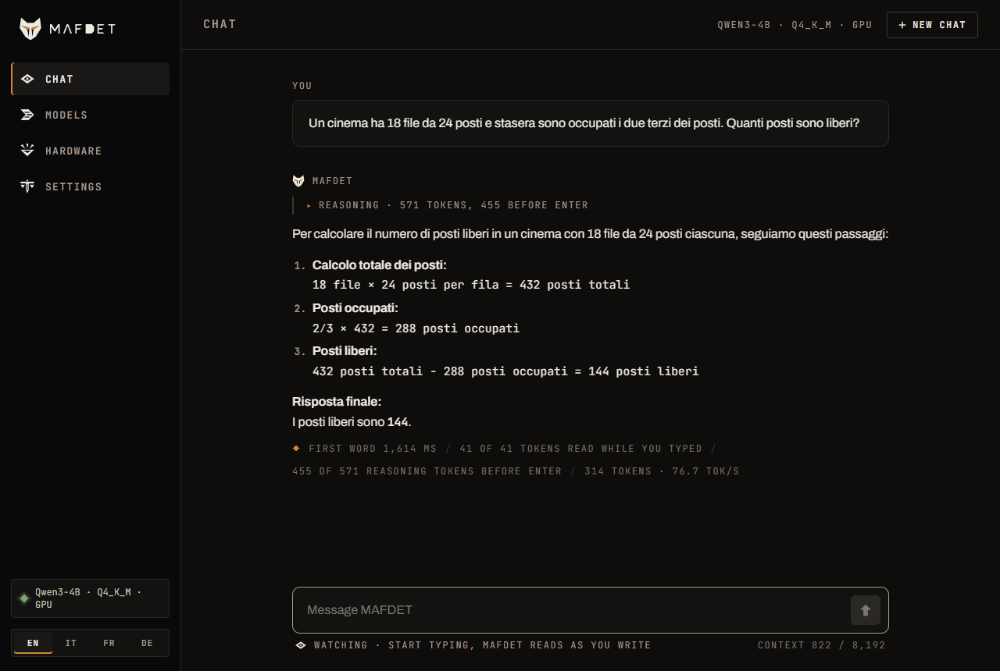
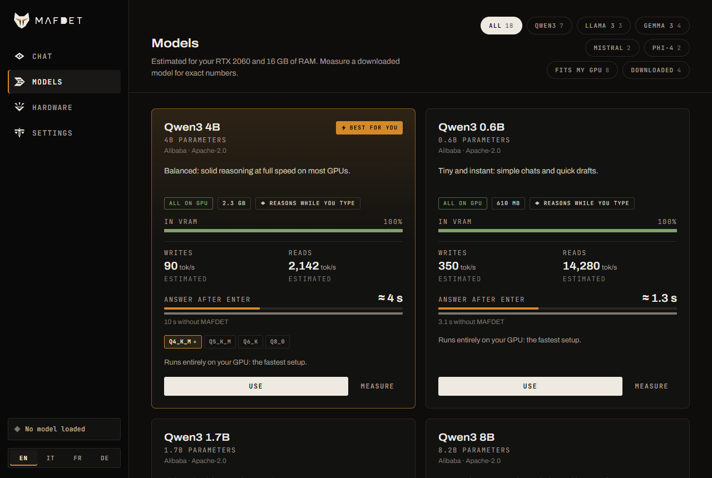
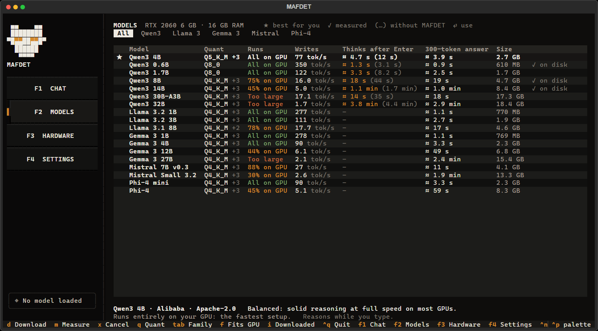
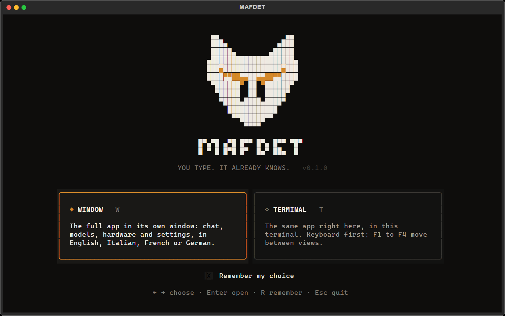

<div align="center">

<picture>
  <source media="(prefers-color-scheme: dark)" srcset="assets/mafdet-logo-dark.svg">
  
</picture>

<h1>
<picture>
  <source media="(prefers-color-scheme: dark)" srcset="assets/mafdet-wordmark-dark.svg">
  
</picture>
</h1>

### You type. It already knows.

MAFDET reads your message while you type it and gets your local LLM ready to answer.<br>
Hit enter, and the response starts right away.

[](LICENSE)
[](#requirements)
[](#roadmap)

[Italiano](README.it.md)

</div>

---

## Why

Chat interfaces make the model wait for you to press enter before it does anything. While you type, the GPU sits idle. When you send, the model first has to *read* your whole message (prefill), and only then can it start answering.

On expensive hardware, reading is fast enough that nobody notices. On a mid-range GPU, a laptop or a CPU, reading a long prompt can take whole seconds, and that is exactly what MAFDET hides.

MAFDET is built for the hardware most people actually own. The reference machine is an **RTX 2060 with 6 GB of VRAM**, and everything also runs on **CPU only**.

> Named after Mafdet, the ancient Egyptian feline goddess known as "the runner", who struck snakes and scorpions before they could attack.

## How it works

An LLM processes text in two phases:

| Phase | What happens | Speed |
|---|---|---|
| **Prefill** | reads the prompt; all tokens are processed in parallel | fast |
| **Decode** | generates the answer, one token at a time | slow |

While reading, the model stores intermediate results for every token in the **KV cache**. Those results never change for a given prefix, so they can be computed ahead of time.

MAFDET keeps the KV cache in sync with the text **while you type**:

1. On every pause, it tokenizes the current text.
2. It holds back the last few tokens, because a word you are still typing can still change how the text is split into tokens.
3. It finds the **longest common prefix** between the new tokens and the ones already in cache, trims the cache there, and prefills only what is new.
4. When you hit enter, only a handful of tokens are left to process.

**Correctness does not depend on how you type.** Backspaces, edits in the middle of the text, pasted blocks, missing punctuation or spaces: the common-prefix check always brings the cache back to exactly what a from-scratch computation would produce. Heuristics such as hold-back and debounce only affect how much work is wasted, never the result.

## Quick start

```bash
git clone https://github.com/TheLastOxygen/mafdet.git
cd mafdet
python -m venv .venv          # Windows: py -3.12 -m venv .venv
source .venv/bin/activate     # Windows: .venv\Scripts\Activate.ps1
pip install -e .
mafdet
```

That is all. No PyTorch, no manual downloads: `mafdet` asks whether to open the **window** or the **terminal app**, and the first start guides you through the rest. It looks at your machine, installs the right build of llama.cpp by itself (CUDA for an NVIDIA card, CPU otherwise) and downloads the model that runs best on your hardware. On Windows, `start_mafdet.bat` does the same with a double-click.

<p align="center">
  
  
</p>

## The app

The same app comes in two forms, on the same engine:

| | Command | What it is |
|---|---|---|
|  | `mafdet gui` | **The window**: chat, models, hardware and settings, in English, Italian, French or German |
|  | `mafdet tui` | **The terminal app**: the same views in the terminal, keyboard first (F1 to F4) |
|  | `mafdet models` | the model catalog for this machine (`--family`, `--download`) |
|  | `mafdet doctor` | checks the GPU, memory, llama.cpp and the models; `--install` installs llama.cpp |

`mafdet` alone opens the launcher, which can remember your choice (`mafdet --ask` shows it again).

**Chat.** While you type, a status line under the message shows what the model is doing with it: how much it has read, and how many reasoning tokens it has written ahead (the field glows amber while it thinks). On Enter only the tail is left to compute. The reasoning is shown folded above the answer, and every answer ends with its numbers: first word after Enter, tokens read while you typed, reasoning done before Enter, speed.

**Models.** Five families: **Qwen3**, **Llama 3**, **Gemma 3**, **Mistral** and **Phi-4**, from 0.6B to 32B parameters, each in several quantizations. With every model, MAFDET reads your message while you type and, at a pause, writes the answer ahead; Qwen3 also **reasons ahead**, the one family whose reasoning frame was measured. Every model of the catalog comes with what it does on *your* machine, before you download it: whether it fits in VRAM or runs partly on the CPU, how fast it writes and reads, and how long the answer takes after Enter with and without MAFDET. The estimate comes from your hardware (GPU and RAM bandwidth, VRAM, llama.cpp's split of layers between GPU and CPU) and is within 12% of the measured speeds on the reference PC (Qwen3-4B 89.6 estimated / 87.1 measured tok/s, 8B 16.2 / 16.2, 14B 5.1 / 4.9). Once a model is downloaded, **Measure** benchmarks it in half a minute and the real numbers replace the estimate. The model that runs best here is marked *Best for you*, and each family has its own best pick. To add a model, add a line to `tools/build_catalog.py`: it reads the file sizes and the shape of the model from Hugging Face.

**Hardware and settings.** The Hardware view shows the GPU, CPU, memory and the llama.cpp runtime, with a button to install or reinstall it. Settings keep the chat options from one start to the next (in `~/.mafdet`, or `$MAFDET_HOME`).

<p align="center">
  
  
</p>

## Requirements

- **Windows or Linux**, with an **NVIDIA GPU** and up-to-date drivers (tested target: RTX 2060, 6 GB), or just a CPU
- **Python 3.10 or later**
- Disk space for the models: from 0.6 GB (Qwen3-0.6B) to 2.3 GB for the 4B recommended on 6-8 GB cards
- **16 GB of RAM** recommended for CPU-only runs and for models larger than the VRAM

The app needs no PyTorch: llama.cpp runs the models, and transformers only provides the tokenizers. PyTorch is needed only for the measurements on the PyTorch backend (below): install it first from the CUDA index, then `pip install -e ".[research]"`.

## How the chat thinks ahead

In the app this is on by default for Qwen3 (Settings, *Reason while I type*); from the command line it is `mafdet strike`, with the options below. The model **starts thinking about your message while you are still typing it**. It runs Qwen3 in thinking mode, so before answering the model reasons in a hidden block (shown folded above the answer). That reasoning is usually the longest wait, and `strike` moves as much of it as possible to before Enter:

1. **While you type**, the model reasons in short chunks of 32 tokens, on the message as it is at that moment, on whole words (after a space or punctuation, or at a pause).
2. **When the text changes**, the reasoning is not thrown away. It stays in the prompt as notes, after the new version of the message. Moving it there only costs a prefill: the fast, parallel phase, about 60 times faster than writing the same tokens again for the 14B on the RTX 2060. A new line of the notes names the words just typed, so the model goes on gathering material on them instead of starting over.
3. **On Enter**, a last sentence tells the model that the message is now complete. It finishes reasoning from where it got to and answers.

The notes are a list of **material for the answer**, started by a frame: *"The user is still typing. I will not wonder what they will ask, nor remark that the text is unfinished. While I wait, I collect material for the answer: for each key term, name or number already written, one line with what it is and the facts I know about it, or a partial result."* followed by one example line from a different message. Each time you type more, a new line names the new words: `- New words "finestra di contesto": `. So from *"Quando finisce la finestra di contesto degli LLM?"* the notes already hold what a context window is and what LLM stands for, and from a word problem the partial results (`3 × 12 = 36`) before the question has been typed.

The frame matters. Without one, the model spent its notes remarking that the message was unfinished, and after every edit it copied its last paragraph again. On six messages typed in real time, the share of sentences in the notes about the user or the message itself (instead of its content) went from 86% with a generic frame (*"work out what you can"*) to 41-54% with this list, and to 17-26% with the example line and a logit bias that, while reasoning ahead and only then, makes words such as *user*, *incomplete*, *typing* less likely (their token ids come from the tokenizer of the model loaded, so it works with any model). Thinking mode also uses the presence penalty suggested by Qwen3's authors, which keeps the 4B out of loops that repeat a sentence until the token limit.

**If you pause and send the message unchanged**, `strike` goes further and also writes the answer itself. That part is exact: the answer only holds for the exact text it was written for, and any change drops it. With `--no-think` (no reasoning) this is all `strike` does, and with greedy decoding the answer is identical token by token to the one started after Enter (checked).

Reasoning ahead is **not exact**: the model reasons on intermediate versions of the message, so the answer can differ from the one it would give starting from scratch. That is why it was measured on answers that can be checked (below).

| Option | What it does |
|---|---|
| `--no-think` | no reasoning: answer right away, and write ahead only the exact answer |
| `--think-ahead N` | longest reasoning kept across edits (default 1024 tokens) |
| `--ahead N` | answer tokens written ahead when the text does not change (default 512) |
| `--recycle` | reuse the answers written for earlier versions of the message as n-gram drafts for speculative decoding (+4% decode speed measured with natural typing, +20% on code) |
| `--draft repo:file` | a small model of the same family drafts tokens for speculative decoding (no gain measured on the RTX 2060, see below) |

`mafdet watch` and `mafdet strike` open the window with the model and options given on the command line (`--gguf repo:file`), instead of the app's settings. `demo_live.py` (`start_demo.bat`) is the step-by-step view for debugging: tokens, cache, hold-back and timings, live in the terminal (`--auto` types an example by itself).

## Measure and verify

| | Command | | What it does |
|---|---|---|---|
|  | `mafdet hunt` | the hunt | simulates people typing and measures the wait after sending |
|  | `mafdet race` | the race | benchmarks prefill and decode on your machine |
|  | `mafdet judge` | the judgement | checks results against a from-scratch computation: must end with 0 errors |
|  | `mafdet awaken` | the awakening | checks PyTorch and the GPU, for the PyTorch backend |

They run on llama.cpp with `--backend llama` (no PyTorch needed), or on PyTorch/transformers with the default `--backend hf` (`pip install -e ".[research]"` after installing PyTorch from the CUDA index: from PyPI, on Windows, pip would get the CPU-only build). `mafdet --help` is the full guide, `mafdet <command> --help` the options of one. Add `--device cpu` to any command to measure the no-GPU case. Results are saved as CSV files in `results/` (change it with `--out`).

### Typing scenarios

`mafdet hunt` replays three scenarios (pick them with `--scenario`):

- **clean**: a message typed from start to finish
- **messy**: typos fixed with backspace, a word deleted and retyped, an insertion in the middle, little punctuation
- **paste**: a long document pasted in, followed by a typed question. This is where the gain is largest.

The typing is not replayed in real time. Each prefill really runs on the model, and its measured duration is placed on the typing timeline. If the model falls behind the typist, the delay piles up and is added to the final wait, just as in a real system.

## Results

All on an RTX 2060 (6 GB), llama.cpp, Q4_K_M models, real-time typing (5 to 8 characters per second, a few natural pauses, Enter right after the last character, no rereading).

**Reasoning ahead, Qwen3-4B** (fits in VRAM, 83 tok/s): 24 word problems with a known numeric answer, typed in Italian.

| | Without reasoning ahead | `mafdet strike` |
|---|---|---|
| Correct answers | 24/24 | 24/24 |
| Median wait for the first word of the answer | 10.7 s | **2.9 s** |
| Mean wait | 12.2 s | **3.2 s** |
| Faster | | in 24 of 24 problems |
| Reasoning in total | 944 tokens | **662 tokens** |
| Reasoning left after Enter | 944 tokens | **244 tokens** |

Same accuracy, less reasoning in total (the material gathered while typing saves the model from starting over), and almost two thirds of it done before Enter. The two earlier frames, measured the same way: a generic frame gave 22/24 and a median of 4.4 s; no frame gave 22/24, 6.9 s and 70% more reasoning.

**Exact answer ahead, Qwen3-4B, no reasoning** (pause before Enter, text unchanged):

| Answer | Written before Enter | Full answer on screen after Enter, strike | Without strike |
|---|---|---|---|
| 300 tokens | 200 | 1.2 s | 3.5 s |
| 168 tokens | 168 (all of it) | instant | 1.9 s |

**Larger models.** What the model can do before Enter is bounded by typing time × its writing speed:

| Model | Fits in 6 GB? | Writes | Reasoning written while typing a 30 s message |
|---|---|---|---|
| Qwen3-4B | yes | 83 tok/s | most of it |
| Qwen3-8B | no, partly on the CPU | about 13 tok/s | 130 to 280 tokens |
| Qwen3-14B | no, partly on the CPU | 5 tok/s | 130 tokens |

Even so, on the 14B (6 word problems typed in real time, 6/6 correct both ways) reasoning ahead halves the mean wait after Enter: **108 s → 47 s**, with 164 reasoning tokens written before Enter on average. Single runs vary a lot (the same problem took 106 s once and 154 s another time), so 6 problems give the order of magnitude, not a precise figure. Reading ahead gains more the larger the model: the 14B reads a 3,000-token pasted document in about 10 s, all of it hidden while you type.

**A small model gathering for a large one (`--gatherer`, experimental).** For models larger than the VRAM we tried having a small, fast model (Qwen3-0.6B, also fine-tuned for it with `training/`) write material while you type, for the 14B to read on Enter. On the RTX 2060 it does not beat the 14B reasoning ahead by itself:

| 14B, mean wait after Enter | |
|---|---|
| No reasoning ahead | 108 s |
| **Reasoning ahead by itself** | **47 s** |
| Gatherer, untrained Qwen3-0.6B | 60 s |
| Gatherer, fine-tuned Qwen3-0.6B | 79-86 s |
| Ideal material, written by hand (every partial result right), presented as "from a fast assistant" | 62 s |
| The same ideal material, presented as the model's own reasoning | 49 s |

Even perfect material only matches reasoning ahead: the 14B reads it, then redoes and double-checks the calculations, except on the easiest problems (17-24 s instead of 37-63 s). How the material is presented matters more than its quality (62 s → 49 s). Open questions for anyone who wants to take this further: combining both (the large model reasons ahead *and* reads the material as its own), teaching the large model to trust partial results, or a gatherer where the large model cannot reason ahead at all (CPU only).

**Tried, and why they are not on by default:**

- `--recycle` (answers to earlier versions of the message as n-gram drafts): +4% decode speed with natural typing, +20% on code, slightly later first token.
- `--draft` (Qwen3-0.6B drafting for the 14B): on the GPU it takes VRAM from the 14B, which then runs more of its layers on the CPU (4.8 → 3.5 tok/s); on the CPU it gains 8% with 4-token drafts and halves the reading speed.

## Roadmap

- [x] Incremental prefill engine with common-prefix sync and token hold-back
- [x] Benchmarks, typing simulation and correctness checks
- [x] Unified `mafdet` CLI
- [x] `mafdet watch`: the chat window
- [x] llama.cpp backend with quantized (GGUF) models
- [x] `mafdet strike`: reasoning ahead while you type, kept across edits; the exact answer ahead at a pause
- [x] The app: window and terminal, model catalog with estimates for your hardware, automatic llama.cpp setup, guided first start, four languages
- [x] A small model gathers while you type, a large one answers: tried and measured (no gain on the RTX 2060, see Results)
- [ ] Reasoning ahead for models larger than the VRAM that beats the large model thinking by itself
- [x] Five model families: Qwen3, Llama 3, Gemma 3, Mistral, Phi-4
- [ ] Reasoning ahead beyond Qwen3, including the thinking models with their own formats (DeepSeek-R1, gpt-oss): each needs its frame measured
- [ ] macOS (Metal) and AMD GPUs

## Related research

- [LiveMind: Low-latency Large Language Models with Simultaneous Inference](https://arxiv.org/abs/2406.14319)
- [StreamingThinker: Large Language Models Can Think While Reading](https://arxiv.org/abs/2510.17238)
- [SHANKS: Simultaneous Hearing and Thinking for Spoken Language Models](https://arxiv.org/abs/2510.06917)
- [Asynchronous Reasoning: Training-Free Interactive Thinking LLMs](https://arxiv.org/abs/2512.10931)

## License

[Apache-2.0](LICENSE)
